# 📊 Awesome Project Analytics & Reporting 📈

  <b>A production-grade, curated collection of top SaaS products, enterprise BI engines, and open-source project analytics tools.</b> 
  <i>Track sprint metrics, velocity, cycle time, burndown trends, portfolio health, and automated PMO dashboards.</i>

[Explore SaaS](#-saas-hosted-platforms) • [Open-Source Solutions](#-open-source-github-projects) • [Sector Dynamics](#-sector-overview--market-dynamics) • [Contribution Guide](#-how-to-contribute)

---

## 📑 Table of Contents

- [🌐 Sector Overview & Market Dynamics](#-sector-overview--market-dynamics)
- [☁️ SaaS / Hosted Platforms](#-saas-hosted-platforms)
- [💻 Open-Source GitHub Projects](#-open-source-github-projects)
- [💡 Architectural Evaluation & Frameworks](#-architectural-evaluation--frameworks)
- [🤝 How to Contribute](#-how-to-contribute)
- [💖 Support & Sponsorship](#-support--sponsorship)
- [⭐ Star History](#-star-history)
- [⚖️ Disclaimer & Governance](#-disclaimer--governance)

---

## 🌐 Sector Overview & Market Dynamics

The global project portfolio management and project analytics software market is estimated at **$6.2 Billion in 2026** (expanding at an ~11.8% CAGR toward $10.5B by 2030), driven by the rapid transition to automated developer analytics, AI-assisted sprint forecasting, and executive PMO visibility.

The sector is **moderately fragmented**: mega-cap hyper-scalers (Microsoft Power BI, Google Cloud Looker, Salesforce Tableau) anchor high-end enterprise data lakes, while agile specialist platforms (Atlassian Jira, Screenful, eazyBI) capture domain-specific daily agile telemetry. High switching costs in team issue tracking prevent a winner-take-all monopoly, sustaining rich ecosystems across both dedicated agile metric providers and open-source self-hosted analytics engines.

---

## ☁️ SaaS / Hosted Platforms

Below is the comparative breakdown of leading Project Analytics & Reporting SaaS platforms, sorted by **Company Size / Valuation / Annual Revenue (Descending)**.

| Platform / Vendor 🏢 | Company Size / Revenue / Valuation 💰 | Starting Tier Pricing 💵 | Free Tier / Trial Limits ⏱️ | Core Analytics Focus & Capabilities 🎯 |
| :--- | :--- | :--- | :--- | :--- |
| **[Power BI](https://powerbi.microsoft.com/)** (Microsoft) | **~$3.1 Trillion** market cap / $245B+ ARR | **$10.00 / user / month** (Power BI Pro) | **Free forever plan** (Power BI Desktop; single-user report authoring, no cloud publishing/sharing). Also 60-day cloud trial. | Enterprise BI, DAX measures, automated Power Query transformation, native Azure DevOps / Jira connectors, and executive portfolio dashboards. |
| **[Looker](https://looker.com/)** (Google Cloud) | **~$2.1 Trillion** market cap (Alphabet) / $40B+ Google Cloud ARR | **$5,000 / month** (Looker Standard Platform base) + user licenses | **30-day guided enterprise trial** with cloud sandbox access and sample database modeling; no permanent free tier. | Governed semantic modeling with LookML, in-database BigQuery computation, git-versioned metric definitions, and embedded enterprise project KPI reporting. |
| **[Tableau](https://www.tableau.com/)** (Salesforce) | **~$300 Billion** market cap (Salesforce) / $38B ARR | **$15.00 / user / month** (Tableau Viewer; Creator tier $75/mo) | **Tableau Public** (100% free, limited strictly to publicly accessible data published online). Also 14-day fully featured free trial. | Gold-standard exploratory visual data analytics, rich drag-and-drop dashboarding, multi-source blending across Jira, ServiceNow, and enterprise SQL databases. |
| **[Datadog Project Analytics](https://docs.datadoghq.com/)** | **~$42 Billion** market cap / $2.6B+ ARR | **$15.00 / host / month** (Pro Infrastructure tier) | **14-day full-access free trial** with full data ingest and pipeline monitoring; no credit card required. | Engineering cycle time, deployment frequency, CI/CD telemetry, and tracking DORA delivery metrics directly alongside production infrastructure observability. |
| **[Jira Reporting](https://www.atlassian.com/software/jira/guides/reports-dashboards/overview)** (Atlassian) | **~$45 Billion** market cap / $4.4B+ ARR | **$7.75 / user / month** (Standard tier) | **Free forever plan** for up to **10 users** (2 GB file storage, unlimited sprint boards, basic burndown & velocity reports). | Native Agile Scrum & Kanban telemetry, release burnup, cumulative flow diagrams, sprint health, and cross-project dashboard gadget aggregation. |
| **[Zoho Analytics](https://www.zoho.com/analytics/)** (Zoho Corp) | **$1 Billion+** annual ARR (Bootstrapped / Private) | **$24.00 / month** (Basic plan, 2 users & 0.5M rows) | **Free forever plan** limited to **2 users, 5 workspaces, and 10,000 rows** of data. Also 15-day free trial on premium tiers. | Deep integration with Zoho Projects and Zoho Sprints, auto-blended project financial reporting, AI conversational query engine (Zia), and 40+ project KPI templates. |
| **[Domo](https://www.domo.com/)** | **~$350 Million** market cap / $320M ARR | **$300.00 / month** (Standard consumption package) | **30-day free trial** with full platform access, 1,000+ connectors, and sample business datasets. | Real-time cloud executive dashboards, pre-built cross-functional connector libraries, mobile-first project alerts, and automated ETL pipelines. |
| **[GoodData](https://www.gooddata.com/)** | **~$150 Million** estimated valuation (Growth Stage) | **$30.00 / workspace / month** (Professional edition) | **30-day fully functional free trial** supporting custom data pipelines and embedded analytics playgrounds. | Headless BI engine, metrics-as-code architecture, embedded project dashboards, multi-tenant workspace analytics, and interactive analytics APIs. |
| **[eazyBI](https://docs.eazybi.com/)** | **~$15 Million** estimated ARR (Independent Bootstrapped) | **$10.00 / month** (Cloud starter tier for up to 10 Jira users) | **30-day unrestricted free trial** on Atlassian Marketplace with full MDX OLAP engine and reporting features. | Multi-dimensional OLAP analysis for Jira & Confluence, custom MDX calculations, Rovo AI project summaries, and automated CLI dashboard management. |
| **[Screenful](https://screenful.com/)** | **~$5 Million** estimated ARR (Independent Venture) | **$39.00 / month** (Starter plan covering up to 10 active users) | **14-day fully featured free trial** with unlimited data sources, custom charts, and automated report scheduling. | Turnkey Agile analytics engine for Jira, Trello, ClickUp, and GitHub; AI natural-language chart creator, sprint velocity, cycle time histograms, and forecast models. |

---

## 💻 Open-Source GitHub Projects

Explore the top self-hosted and community-driven project analytics, business intelligence, and engineering metrics platforms, sorted by **GitHub Stars (Descending)**.

| Project & Repository 📦 | GitHub Stars ⭐ | License 📜 | Architecture & Capabilities 🛠️ |
| :--- | :--- | :--- | :--- |
| **[Grafana](https://github.com/grafana/grafana)** |  | AGPL-3.0 | Modern real-time operational dashboarding and visualization platform. Connects to PostgreSQL, MySQL, ClickHouse, and Prometheus to monitor sprint velocity, issue resolution rates, and CI/CD pipelines. |
| **[Apache Superset](https://github.com/apache/superset)** |  | Apache-2.0 | Enterprise-grade cloud-native BI web application with 40+ visualization plugins, robust SQL Lab, granular RBAC, and seamless database connectivity to Jira SQL exports, Redmine, and PostgreSQL. |
| **[Plane](https://github.com/makeplane/plane)** |  | AGPL-3.0 | Next-generation open-source software development tracker featuring native cycle analytics, burnup/burndown trends, project workload distribution, and lead time metrics. |
| **[Metabase](https://github.com/metabase/metabase)** |  | AGPL-3.0 | User-friendly self-service BI platform with visual query builder, automated drill-downs, and email/Slack alerting. Ideal for non-technical PMs querying project tracking databases without SQL. |
| **[Cube](https://github.com/cube-js/cube)** |  | Apache-2.0 | Universal semantic layer and headless analytics engine. Models project metrics (cycle times, throughput, budget utilization) centrally and feeds consistent numbers to custom internal portals. |
| **[OpenProject](https://github.com/opf/openproject)** |  | GPL-3.0 | Complete self-hosted project management platform. Features native project cost reporting, time tracking, budget reports, and upcoming native Agile sprint velocity and cumulative flow diagrams. |
| **[Planka](https://github.com/plankanban/planka)** |  | AGPL-3.0 | Elegant open-source Kanban board platform with built-in time tracking, task completion trends, and project activity audit logs for agile delivery teams. |
| **[Leantime](https://github.com/leantime/leantime)** |  | AGPL-3.0 | Strategic project management platform for non-project managers. Combines OKR tracking, milestone progress, sprint burndown, and AI-assisted task health assessments. |
| **[Evidence](https://github.com/evidence-dev/evidence)** |  | MIT | Code-based business intelligence framework (Markdown + SQL). Build fast, version-controlled project status reports, sprint summaries, and PMO decks rendered as static web apps. |
| **[Lightdash](https://github.com/lightdash/lightdash)** |  | MIT | Open-source Looker alternative built natively on dbt. Enables engineering teams to define project data metrics in dbt models and share self-serve dashboards across departments. |
| **[Apache DevLake](https://github.com/apache/incubator-devlake)** |  | Apache-2.0 | Purpose-built open-source dev data platform. Ingests data from Jira, GitHub, GitLab, and SonarQube to calculate engineering throughput, DORA metrics, and sprint cycle efficiency out-of-the-box. |
| **[Redmine Reporting](https://github.com/likehopper/redmine_reporting)** |  | GPL-2.0 | Native Redmine dashboard plugin providing real-time issue flow monitoring, time budget consumption charts, workload distributions, and Chart.js graphical visualizations. |

---

## 💡 Architectural Evaluation & Frameworks

When choosing between SaaS platforms and open-source analytics infrastructure:

- **Turnkey Agile Metrics**: Commercial tools like **Screenful** and **eazyBI** feature out-of-the-box support for Agile formulas (lead time distributions, Monte Carlo forecast simulations, and multi-dimensional Jira MDX queries) without ongoing data pipeline maintenance.
- **Engineering & DORA Metrics**: For automated engineering lifecycle telemetry, **Apache DevLake** provides dedicated connectors for GitHub/GitLab/Jira, standardizing delivery KPIs with zero custom ETL scripting.
- **Enterprise PMO Data Lakes**: Platforms like **Microsoft Power BI**, **Tableau**, and **Apache Superset** excel when project metadata must be cross-analyzed with corporate ERP, Salesforce CRM, or general financial ledger accounts.
- **Semantic Layer Governance**: Deploying **Cube** or **Lightdash** ensures that metrics such as "Story Point Velocity" or "Billable Utilization" remain universally defined across all internal dashboards and reports.

---

## 🤝 How to Contribute

Contributions are warmly encouraged! Help keep this directory comprehensive and up to date:

1. 🍴 **Fork** this repository.
2. 🌿 Create a descriptive feature branch (`git checkout -b feature/add-new-project-tool`).
3. 📝 Update `README.md` maintaining table formatting, verified starting prices, exact free tier limits, and accurate repository star links.
4. 🚀 Commit your updates with clear messages (`git commit -m "feat: add NewTool to OSS table"`).
5. 📤 Push your branch and submit a **Pull Request**.

---

## 💖 Support & Sponsorship

Thank you so much for using and supporting this curated resource! If you find this directory valuable for your engineering team, project management office (PMO), or business intelligence workflows:

- ⭐ **Star** this repository to help other developers and managers discover it.
- 🍴 **Fork** and contribute new tools, updates, or benchmark corrections.
- 📢 **Share** it with your colleagues and across developer communities on LinkedIn, X/Twitter, or Reddit.
- ☕ **Buy me a coffee**: If you'd like to support ongoing maintenance and new curated additions, consider sponsoring via the [Sponsor Dashboard](https://github.com/sponsors/ishandutta2007).

---

## ⭐ Star History

---

## ⚖️ Disclaimer & Governance

- This list is independently curated by the open-source community for informational and evaluation purposes.
- Platform trademarks, brand logos, and service names belong to their respective owners.
- Self-hosted open-source deployments require operators to manage their own data pipeline reliability, access controls, GDPR compliance, and backup strategies.
- Please verify licensing terms before production deployment: Apache 2.0 and MIT permit enterprise adoption, while AGPL-3.0 and GPL-3.0 impose copyleft obligations on server-side distribution and modifications.

---

  Built with ❤️ for Project Managers, Scrum Masters, PMO Leaders, and Data Engineers worldwide. 
  ⭐ <b>Star this repo if it helps your team make data-driven project decisions!</b> ⭐

